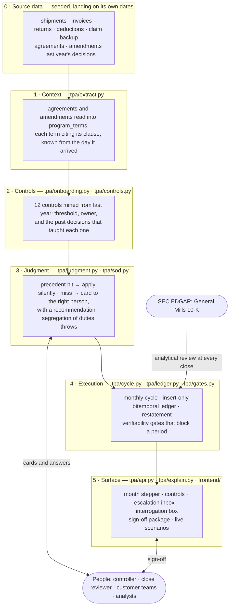
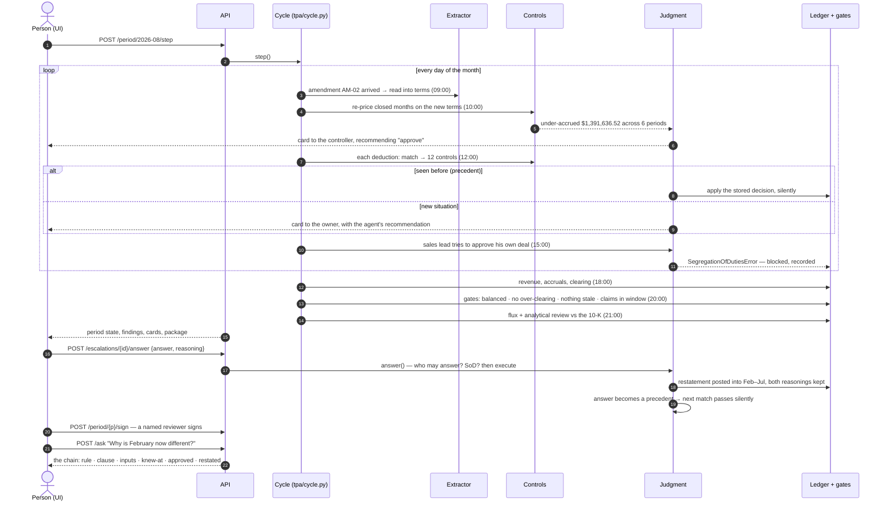

# Architecture

Six layers, one agent owning one function. **Every number is computed by deterministic code.** The model
drafts questions, plays the people in an unattended run, and phrases answers; it never computes a number,
never approves, and any reply that changes a number or record id is discarded.



## How a month runs

Each **Step** runs one simulated month. Source rows are handled on the day they arrive, in the order the
business would see them; the close runs on the last day.



## Code map

| Module | Role |
|---|---|
| `db/schema.sql` | the DDL; triggers make the ledger insert-only, journals balance and signed periods lock |
| `tpa/extract.py` | layer 1: agreements and amendments into `program_terms`, each term citing its clause; Claude as an optional second reader |
| `tpa/onboarding.py` | replays last year, mines thresholds, owners and precedents into `controls`; derives priors |
| `tpa/controls.py` | one check per control, shared by the replay and the live cycle |
| `tpa/judgment.py` | precedent match, escalation routing, recommendations, `answer()`, follow-ups |
| `tpa/sod.py` | segregation of duties, `can_approve` |
| `tpa/players.py`, `tpa/autopilot.py` | played humans for unattended runs; last year's answers as a baseline |
| `tpa/cycle.py` | the monthly engine and the period state machine; late backup, handoffs |
| `tpa/graph.py` | the close as a LangGraph agent: runs the month, interrupts for each card and the sign-off |
| `tpa/execute.py` | every posting a decision can lead to |
| `tpa/restate.py` | restatement: catch-ups into closed months, withdrawing our own superseded disputes |
| `tpa/ledger.py` | `post_journal`, the only write path; its docstring is the posting contract |
| `tpa/asof.py` | the bitemporal reads: `balances_as_of`, `entries_as_of`, `terms_as_of`, `entry_history` |
| `tpa/gates.py` | the verifiability gates and `sign_period` |
| `tpa/review.py` | the close's analytical review against the 10-K |
| `tpa/flux.py`, `tpa/package.py`, `tpa/export.py` | flux commentary, the sign-off package, CSV export |
| `tpa/explain.py` | the interrogation chain and `ask()` |
| `tpa/scenario.py` | live scenario injection |
| `tpa/evaluate.py` | scoring against the answer key |
| `tpa/policy.py` | every threshold that isn't mined, labelled as company policy, never GAAP |
| `tpa/model.py` | the only doorway to Claude; off unless `TPA_USE_MODEL=1` and `ANTHROPIC_API_KEY` |
| `tpa/seed/` | the deterministic generator (`fiction.py` frozen, `plant.py` the errors), `calibration.py` the 10-K figures |

## Engine hooks

`tpa.cycle.Hooks` is where judgment and people plug in. Alone, the engine decides only what a mined control
allows the agent, and never approves or signs.

| Hook | Called | Default |
|---|---|---|
| `judge(cur, finding, at)` | as each finding is raised, and at close for any still open | mechanical controls (duplicates, no proof, late returns) auto-resolve; the rest stay open |
| `on_event(cur, event, at)` | on a scripted human action's date | ignored |
| `approve(cur, restatement, at)` | when a restatement is proposed | none: waits for a person |
| `sign(cur, period, customer_id, at)` | for each clean customer-period | none: stops at REVIEWED |
| `follow_up(cur, period, at)` | at the close, before sign-off | none |

`judgment.hooks()` wires the judgment engine with cards left for people; `players.hooks()` adds the played
humans. Finding `evidence` always carries `summary`, `control` and the ids involved.

## The close as a LangGraph agent

`tpa/graph.py` wraps one month's close in a LangGraph `StateGraph`, so a person can work it from a paused,
checkpointed graph instead of the inbox:

```
START → run_month → cards ⇄ (one card per pass) → sign → report → END
```

- **run_month** is `cycle.step` with `judgment.hooks()`: the engine runs exactly as it does from the API.
- **cards** raises a LangGraph `interrupt` for each open card, addressed to the person it is for. The reply
  (`{"answer", "answered_by"?, "reasoning"?}`, or `{"skip": true}`) goes through `judgment.answer`, so
  roles, segregation of duties and the reasoning an override needs are checked as they are at the API. A
  refused answer is logged and the same card is asked again; a blocked attempt is still recorded as a finding.
- **sign** interrupts once with each unsigned customer's open findings and failing gates; the reply
  (`{"customers": [...], "signed_by"?}`) signs through `gates.sign_period`, so a failing gate still blocks.
- **report** returns each customer's period state and any cards still open.

The graph orchestrates and never computes an amount: every posting still goes through `tpa.execute` and
`post_journal`. Each node opens its own connection and commits before it returns, so a checkpointed graph
can resume later, from another process. `scripts/graph_close.py` drives it at the terminal
(`--recommended` takes every recommendation and signs what is clean).
